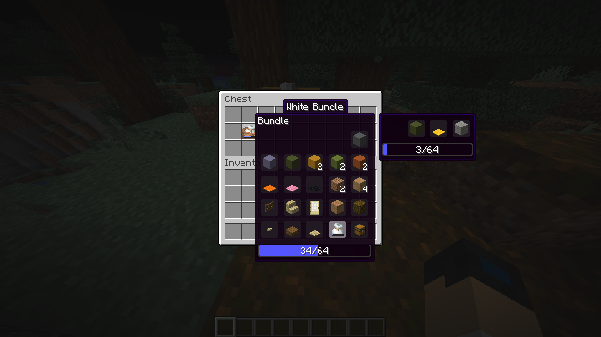

# Nested Bundle Viewer

Nested Bundle Viewer makes Minecraft bundles easier, clearer, and less annoying.

## What it does

Vanilla bundles only display up to 12 items. Anything beyond that is hidden, which makes bundles confusing to use. This mod removes that limit entirely and shows **all** items inside a bundle.

It also adds proper support for nested bundles. When you select a bundle in your inventory, its contents are displayed right next to it. If that bundle contains other bundles, those are shown as well. No guessing, no emptying bundles just to see what is inside.

## Features

- Removes the 12 item display limit from bundles
- Displays full bundle contents directly in the inventory
- Supports bundles inside bundles
- No extra screens or menus
- Clean and simple UI behavior

## Client-side only

This mod is **fully client-side** and does not require installation on servers.

Servers can choose to disallow it. The only thing a server can detect is that you may take items out of a bundle in situations where vanilla Minecraft would normally prevent it due to the 12 item display limit.

## Compatibility

- Works on the client only
- Safe to use on servers that allow client-side mods
- Behavior depends on server rules

## Why this mod exists

Bundles are useful, but the vanilla UI hides information and makes them frustrating to use. Nested Bundle Viewer fixes that by showing exactly what is inside, nothing more and nothing less.


## Supported versions
| Minecraft | Loaders | Java |
|---|---|---|
| 1.21.11 | Fabric, NeoForge | 21 |
| 26.1.2 | Fabric, NeoForge | 25 |
| 26.2 | Fabric, NeoForge | 25 |
| 26.3 | Fabric, NeoForge | 25 |
## Building
```
./gradlew build -Pmc=<version>
```
Each version has a file in `gradle/versions/<version>.properties` containing dependency versions, the Java version and the `compat_variant`. Code that needs version-specific Minecraft APIs lives in `common/src/compat/<variant>`; shared code stays in `common/src/main`.
### Adding a new Minecraft version
1. Create `gradle/versions/<version>.properties` (copy the closest version).
2. Point `compat_variant` to an existing variant or add `common/src/compat/<new variant>/java`.
3. Build with `-Pmc=<version>` and add the version to the matrix in `.github/workflows/build.yml`.